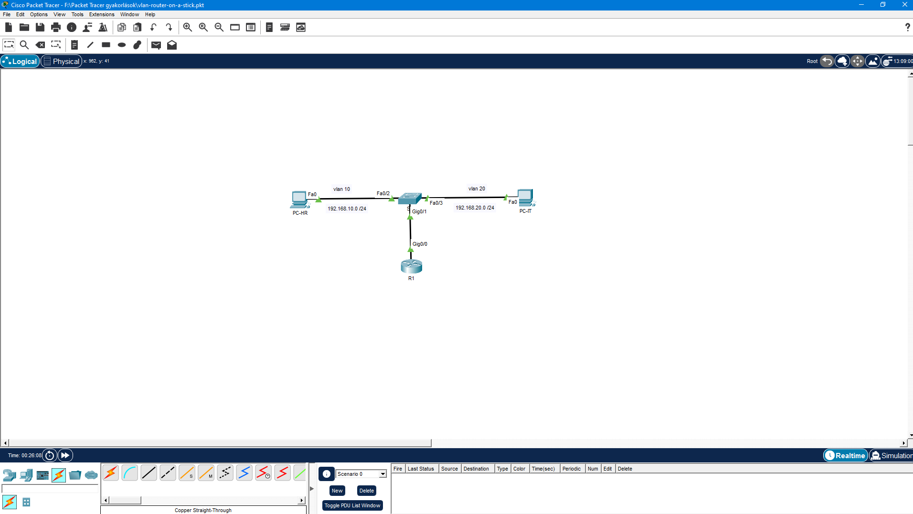

# Cisco Packet Tracer - Router-on-a-Stick (VLAN Routing)

Ez a projekt egy hálózati szegmentációs és útvonalválasztási feladatot mutat be Cisco Packet Tracer környezetben.

## 🛠️ Megvalósított hálózati funkciók
* **VLAN szegmentáció:** Két különálló hálózati zóna létrehozása (VLAN 10 - HR, VLAN 20 - IT).
* **Trunking:** 802.1Q trunking beállítása a switch és a router közötti szakaszon.
* **Inter-VLAN Routing (Router-on-a-Stick):** Al-interfészek (subinterfaces) konfigurálása a routeren a VLAN-ok közötti forgalom átirányításához.
* **Tesztelés:** Sikeres kétirányú ping teszt a két eltérő alhálózat (192.168.10.0/24 és 192.168.20.0/24) között.

## 📐 Hálózati Topológia

## 📁 Fájlok a repóban
* `topologia.png` - A megrajzolt és tesztelt hálózati topológia képe.
* `vlan-router-on-a-stick.pkt` - A letölthető és megnyitható Packet Tracer projektfájl.
